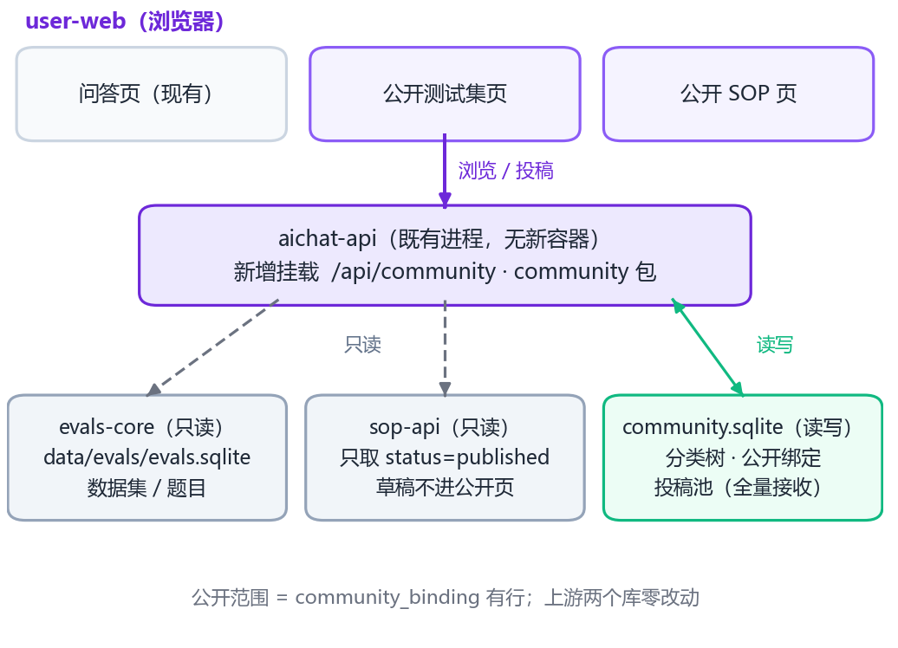

# 公开测试集 / 公开 SOP 两页设计（user-web 模块三）

**状态**：待第二轮评审（未动工，代码零改动）　**日期**：2026-10-15（v2，按第一轮审核意见回写）
**评审重点**：§3 已拍板事项是否兑现、§5 决策是否成立、§6 五条风险处置是否到位、§12 验收是否可执行、§14 新增两条需业主知情的事项。

**v2 相对 v1 的变化**：B1 事实更正（草稿泄漏实测不成立，但查出 SOP 数据面**匿名可写**这一存量现状）、B2 自动绑定改一次性种子、B3 补 nginx 频控与 XSS 闸；N1–N4 全部采纳；新增 F17（生产 SOP 数据为空，影响上线前置）。逐条对应见 §15。

---

## 0. 一页摘要

user-web 现在是单页问答。本设计把它扩成三页：**问答 / 公开测试集 / 公开 SOP**。

一句话方案：**新增一个 community 后端模块（挂在 aichat-api 进程里，不开新容器），公开内容一律只读上游两个库，用户投稿写进自己的独立库。**

```
公开测试集页 ─┐                         ┌─ 只读 ─> evals-core ──> data/evals/evals.sqlite（测试集/题目）
              ├─ /api/community（新） ──┤
公开 SOP 页 ──┘                         ├─ 只读 ─> sop-api   ──> data/platform/sops/（只取 published）
                                        └─ 读写 ─> community.sqlite（分类树 · 公开绑定 · 投稿池）
```

三条不可让步的边界：

1. 用户投稿**永不**写进正式题库和 SOP 库——「先不做审核」的前提是投稿可以先分离、后处理。
2. 公开哪些内容 = `community_binding` 表里有没有这一行，且**由人写进去**（自动绑定只在首次种子跑一次，见 §9.1）。上游两个库**零改动**。
3. 公开页**不许**直连 `/api/sops`、`/api/evals`（无鉴权、含草稿与写口，见 §6 R1/R4）。

> ⚠️ **上线前置（F17，本轮实测）**：生产环境 SOP 数据面是**空的**（`sops/json` 0 文件、快照 2 字节、aichat 内 published=0）。公开 SOP 页现在上线＝空页。需业主二选一：① 首版只上公开测试集页，SOP 页等内容上生产再开；② 先把 SOP 语料上生产（并同步处置 §6 R4）。

---

## 1. 范围与非目标

| 范围内 | 说明 |
|---|---|
| 三页导航 | 问答 / 公开测试集 / 公开 SOP，顶栏可互切 |
| 公开测试集页 | 左树「专业 → 子专业 → 测试集 → 题目」；用户可投稿测试集、投稿题目 |
| 公开 SOP 页 | 左树「专业 → 子专业 → SOP」；只读流程图 + 步骤详情；用户可提意见（可精确到某一步） |
| 投稿全收 | 三类投稿一律落库为 `received`，提交即成功，无审批动作 |
| 绑定运维入口 | 一个 CLI 脚本（列未绑 / 绑 / 解绑），首版不做后台 UI |

| 明确不做（本版） | 归属 |
|---|---|
| 审核工作台、通过/驳回、提升进正式库 | 表已留 `status` 字段，后续单独开工 |
| 公开测试集在线跑评测、榜单 | 与本页无关，另案 |
| 投稿人撤回、回复串、点赞、通知 | YAGNI |
| 改 `services/evals-core`、`services/sop-api` 的存储或接口 | 见 §5 D1 与 §6：代理层解决，不动上游 |
| **sop-api 加鉴权 / nginx 收口 `/api/sops`** | **另案工单（§6 R1/R4 根治）**，不混进本设计 |

---

## 2. 现状事实（评审可逐条复核）

| # | 事实 | 锚点 | 核实方式 |
|---|---|---|---|
| F1 | user-web 只有 3 条路由（聊天、文档深链、catch-all 回聊天），无全局导航 | `apps/user-web/src/router/index.ts:5-21` | 直读 |
| F2 | `/api/evals/*` 除 nightly/parse-regression 外**无鉴权，读写都开着**；中间件只管 `/api/v1`、`/api/chat` | `services/aichat-api/evals_routes.py:78-266`、`:437-445`；`middleware/api_key_auth.py` | 直读路由与中间件 |
| F3 | 测试集与题目在 `data/evals/evals.sqlite`（`eval_dataset` + `eval_question`，八张 gold 为 JSON 列、读回时解析成 dict） | `services/evals-core/src/evals_core/storage/result_store.py:119-158`、`:665-673` | 直读 DDL 与行解析 |
| F4 | `GET /api/sops` 不带 status **连草稿一起返回**；`GET /api/sops/full` 默认 `status=published` | `services/sop-api/sop_routes.py:458`、`:469` | 直读 |
| F5 | sop-api **无任何鉴权中间件**；nginx 只硬 403 了 `synthesize`/`crystallize` 两个 L4 写口，其余（含创建/更新/删除）原样反代 | `services/sop-api/main.py`；`docker/nginx/nginx.conf:119-136` | 直读 + 公网探针（R4） |
| F6 | SOP 源文件步骤含 `ui_meta.position` 与嵌套 `execution`；而快照是 `SOP.model_dump()`，已扁平化且**无 ui_meta** | `data/platform/sops/json/海港航道通航宽度计算.json` vs `data/platform/sop_published_snapshot.json`（键集对比：源有 `ui_meta`/`execution`，快照为 `tool`/`inputs`/`outputs`） | 脚本对比（第二轮复核同结论） |
| F7 | `data/platform/*.sqlite` 是功能域库约定，经 `resolve_data_file("XXX_DB_PATH", "platform/x.sqlite")` | `services/shared/src/shared/paths.py:16-23`；`chat-history/store/sqlite_store.py:26` | 直读 |
| F8 | chat-history = 「功能包挂 aichat-api 主进程」的现成模板（store 自建模 + 路由工厂注入 `resolve_principal`） | `services/chat-history/src/chat_history/routes/sessions.py:84-100`；`services/aichat-api/main.py:395-406` | 直读 |
| F9 | `tree_core` 是通用树节点层（`tree_node` 按 `tree_type` + `scope_id` 隔离，调用方自带连接） | `services/tree-core/src/tree_core/tree_store.py:12-44`、`:190-198` | 直读 |
| F10 | evals-ui 组件 scoped 样式吃 `@evals-*` less 变量；admin 靠 vite `additionalData` 注入，**user-web 未注入** | `apps/admin-web/vite.config.ts:100`；`apps/user-web/vite.config.ts:92` | 直读 + grep |
| F11 | user-web `tsconfig.json` paths **缺** `@angineer/evals-ui`、`@angineer/smartree`（vite 别名有） | `apps/user-web/tsconfig.json:22-29` vs `vite.config.ts:79-85` | 直读 |
| F12 | `SopMetaPanel` 的「审核操作」整块（审核人/意见/通过并发布/驳回/禁用/审计）**不受 `readOnly` 约束** | `packages/sop-ui/src/components/SopMetaPanel.vue:94-131` | 直读模板 |
| F13 | `EvalQuestionCard` **根本没有 `readonly` prop**，且头部「编辑题目」保存时直发 `PUT /api/evals/datasets/{ds}/questions/{qid}` | `packages/evals-ui/src/components/EvalQuestionCard.vue:973-979`（props）、`:45-47`（按钮）、`:1053-1059`（PUT） | 直读 |
| F14 | 游客 cookie 只在两处签发：App 挂载时 token 失效分支、ChatHome 未登录时。**新公开页都不经过这两处** | `apps/user-web/src/App.vue:43-56`；`views/ChatHome.vue:208` | 直读 |
| F15 | 归属键解析顺序：`u:<id>` → `k:<id>` → `g:<游客cookie>` → `ip:<hash>` | `services/aichat-api/chat_auth.py:resolve_pool_owner` | 直读 |
| F16 | 后端镜像 `COPY services/ services/` 全量拷贝，但按包逐个 `pip install -e` 出现**两次**（builder 预装 + 全量 COPY 后重装）→ 新增包要动 **4 处** | `docker/Dockerfile.backend:15-26`（COPY pyproject）、`:28-47`（mkdir/touch）、`:49-60`（首次 pip）、`:74-85`（COPY 后重装 pip） | 直读（v1 漏记第 4 处，已更正） |
| F17 | **生产 SOP 数据面为空**：`data/platform/sops/json` 0 文件、`index.json` 与 `sop_published_snapshot.json` 均 2 字节（`[]`，快照 10-15 07:02 被空覆写）、容器内 `SopApiClient().load_published()` 返回 0 条 | 部署机 `124.221.238.70` 只读 ssh（`ls` + `docker exec`）+ 公网 `GET /api/sops`、`/api/sops/full?status=published\|draft` 全部 `200 {"sops":[]}` | 实测（2026-10-15） |

> 归因说明：F1–F17 均为直读源码、脚本比对或生产只读探针所得，非转述 commit/文档。

---

## 3. 已拍板（业主 2026-10-15）

| # | 事项 | 结论 | 落地形态 |
|---|---|---|---|
| 拍1 | 投稿可见性 | **提交即公开可见** | 树与列表带「投稿」徽标区分来源；`COMMUNITY_SUBMISSION_VISIBILITY=open\|pool` 开关，`pool`=只收不展。滥用防线见 §6 R5（nginx per-IP 频控为主，应用层日限为兜底） |
| 拍2 | 对话页加导航 | **加** | 顶栏品牌右侧插导航（一处小改）。**hero 版式是红线，本设计不动 hero** |
| 拍3 | 分类树种子 | **照用** | 四专业 16 子专业（§9.2）；节点 id 用稳定 ascii slug |
| 拍4 | 投稿身份 | **提示登录，不登录以游客身份继续** | 提交框顶部提示条 +〔登录〕/〔继续提交〕，后者直接放行（§10.3） |

---

## 4. 架构总览与数据流



读链路（浏览）：公开页只调 `/api/community/*`；community 内部读 evals-core（同进程直读库）与 sop-api（HTTP，强制 published）。
写链路（投稿）：公开页 `POST /api/community/submissions` → 只落 `community.sqlite`，状态 `received`。

**为什么公开页不直连 `/api/evals`、`/api/sops`**：那两个前缀是后台工作台的接口面，读写全开且含草稿（F2/F4/F5）。公开页要的是「只读 + 已发布 + 公开投影」，这三条恰好都是上游接口不提供、必须由代理层补的。代理层是唯一的可靠闸门——但它只约束新页，**不修复上游本身的洞**（§6 R1/R4 另案）。

SOP 端点地址复用现有环境变量 `SOP_API_URL`（默认 `http://sop-api:8792`，本机 dev 经 `.env` 覆盖为 `http://127.0.0.1:8792`），不新造配置项（N3）。

---

## 5. 关键决策

| # | 决策 | 备选 | 结论 | 理由 |
|---|---|---|---|---|
| D1 | 后端落点 | ① 新包挂 aichat-api ② 新建独立服务 ③ 塞进 evals/sop 现有 store | **①** `services/community/`，prefix `/api/community` | 两页共用一棵树 + 一个池；模板现成（F8）；② 要多容器/端口/守护，体量不值；③ 违反「投稿可分离」前提 |
| D2 | 「公开」如何界定 | ① 上游加 `is_public` 字段 ② 本模块绑定表 | **②**，且绑定动作由人触发（§9.1） | 上游零改动、零回归；改公开范围=增删一行，不发版 |
| D3 | 投稿落哪 | ① 独立投稿池 ② 直接写正式库 | **①** `data/platform/community.sqlite` | 全量接收 ≠ 全量入库；日后审核提升走已存在的正规入口（`evals_core.import_bundle` / `POST /api/sops`） |
| D4 | 分类树载体 | ① 复用 `tree_core` ② 自建表 ③ 写死 JSON | **①**（`tree_type='community_node'`，`scope_id` 分 eval/sop） | F9 现成；改分类不发版（发版只补新建、不覆盖已改） |
| D5 | SOP 读取形态 | ① 复用 aichat 的 `SopApiClient`（SOP dataclass） ② 自取 raw JSON | **②**，端点与快照路径沿用 `SOP_API_URL` / `SOP_API_SNAPSHOT_PATH` | 画布要 `ui_meta.position` 与嵌套 `execution`（F6），dataclass 路径会丢版面；raw 与 admin 输入同源 |
| D6 | 前端复用 | ① 全面复用 evals-ui/sop-ui ② 公开页自建组件 | **混合 + 补两个 prop** | 复用省 3000+ 行；但 F12/F13 说明现成组件会带出「编辑题目/通过并发布」这类后台按钮，必须能关。新增 prop 默认值=现行为，**admin 零变更** |
| D7 | 题目公开到什么程度 | ① 连参考答案一起公开 ② 只出题干+等级 | **② 默认，开关 `COMMUNITY_SHOW_GOLD=0/1`** | gold 是正式库资产（F3 八张 gold）；答案上网=该题集对公网失效。**仍需产品确认（§14-1）** |

---

## 6. 五条风险与处置

| # | 风险 | 现状定性（实测） | 本设计的处置 | 根治归属 |
|---|---|---|---|---|
| **R1** | 草稿泄漏：`GET /api/sops` 不带 status 吐草稿（F4），端点无鉴权（F5） | **当前无内容可泄**——生产 SOP 数据为空（F17），公网 `?status=draft` 实测 `200 {"sops":[]}`。**但泄漏面是潜在成立**：SOP 一入库，草稿即刻公网可读 | 公开页不许直连；community 只请求 `/api/sops/full?status=published` 并逐条复核 status。**注意：这只保证新页不放大泄漏，不修复洞本身** | **另案工单**：sop-api 加鉴权，或 nginx 拆分「admin 入口 / 公开入口」（admin-web 与新页共用同一 nginx location，直接封会把后台一起关掉，需先拆入口或加 key） |
| **R2** | 答案泄漏：题目接口可带回八张 gold（F3） | 公开投影未落地，风险待发生 | 公开投影默认只出题干/等级/标签；`COMMUNITY_SHOW_GOLD=1` 才带回参考答案 | 本设计内（D7） |
| **R3** | 游客归属踩空：游客 cookie 只在 App 的 token 失效分支和 ChatHome 里签（F14），新公开页两处都不经过 | 成立。直接进公开页的访客落 `ip:<hash>` 桶 → 同 NAT 多人共享日限桶，投稿无法按主体回溯 | 公开页挂载时补一次 `enterGuestMode()`；**提交前再确保一次**（覆盖签发竞态） | 本设计内（§10.3） |
| **R4** | **SOP 数据面匿名可写**（本轮探针新发现，比 R1 更严重）：`DELETE /api/sops/<不存在 id>` 返 **404** 而非 401/403、`POST /api/sops` 坏体返 **422** 而非 401/403 —— 说明请求直达业务层，写路径无鉴权门 | **现状即成立**，与 SOP 是否有数据无关。生产当前空库所以后果未显形；一旦入库，任何人可增改删我们的 SOP 资产 | 本设计**不新增**该面（community 只读）；投稿只落自己的库。风险面属上游既有，不在本页修 | **另案工单（建议与 R1 同单，优先级更高）**：nginx 对 `/api/sops` 的写方法（POST/PUT/DELETE）默认 403，或 sop-api 加会话鉴权 |
| **R5** | 匿名投稿滥用：应用层日限按 `g:<cookie>` 计数，清 cookie 即换桶；`ip:` 兜底被 NAT 共享 ⇒ 应用层限流不是有效防线，且无内容闸 | 新页引入的能力，尚未落地 | 两层：① **nginx `limit_req` 按 `$binary_remote_addr` 对 `POST /api/community/submissions` 频控（主防线）**；② 应用层日限 50/24h 保留为兜底与留痕。内容侧：长度硬上限（§8）+ 渲染禁 `v-html`（§7.3）+ 敏感词闸列为可选项 | 本设计内（T5） |

**给运维/评审的一句话**：R1、R4 是**存量**问题，不因本设计产生、也不会被本设计修复；本页上线前建议至少把 R4 的 nginx 写方法封锁做掉（一行 `if ($request_method ~ ^(POST\|PUT\|DELETE)$) { return 403; }` 级别的收口，先测 admin 端不受影响）。

---

## 7. 文件架构

### 7.1 后端（新增包 + 一个挂载点）

```
services/community/                        ← 新包（import 名 community）
├─ pyproject.toml                          # angineer-community，src layout，依赖 shared / tree-core / fastapi / requests
├─ README.md                               # 边界声明：本库唯一写者；上游只读
├─ src/community/
│  ├─ models.py                            # 常量 + 出参形状（node/binding/submission/tree_item/question_out）
│  ├─ store/sqlite_store.py                # community.sqlite：建表迁移 + DAO（模板=chat_history.store）
│  ├─ sources/eval_source.py               # 只读 evals_core：题集卡 + 题目公开投影（惰性 import）
│  ├─ sources/sop_source.py                # 只读 sop-api：published raw JSON + TTL 缓存 + 快照兜底（复用 SOP_API_URL）
│  ├─ service.py                           # 用例层：build_tree / dataset_detail / questions / sop_detail / comments / submit
│  ├─ taxonomy_seed.py                     # 分类树种子（幂等只补）+ 首次一次性自动绑定（跑过即置 marker）
│  └─ routes/community.py                  # build_community_router(service, resolve_principal) → APIRouter
└─ tests/                                  # 树装配 / 三类投稿 / 草稿不可见 / 日限 / XSS 存储 五组用例

scripts/community_bind.py                  [新] 绑定运维 CLI：list --unbound / bind <kind> <ref> <node> / unbind（首版无后台 UI 时的唯一动作入口）
```

### 7.2 前端（user-web）

```
apps/user-web/src/
├─ router/index.ts                         [改] +/evals、+/sops（catch-all 之前）
├─ api/community.ts                        [新] 本模块客户端（tree / dataset / questions / sop / comments / submissions）
├─ composables/useCommunityTree.ts         [新] /tree → SmartTreeNode[]，含数据集懒展开与选中态
├─ components/
│  ├─ SiteNav.vue                          [新] 三页导航（按 route 高亮）
│  ├─ PublicTopBar.vue                     [新] 公开页顶栏 = AppBrand + SiteNav + 登录/用户动作（克隆 ChatTopBar 右侧）
│  └─ public/
│     ├─ PublicTreePanel.vue               [新] 左树薄封装：SmartTree + 虚拟滚动 + 投稿徽标 slot
│     ├─ SubmitDatasetModal.vue            [新] 投稿测试集（标题/子专业/描述/题目行 + JSON 整包导入）
│     ├─ SubmitQuestionModal.vue           [新] 投稿题目（题干/等级/参考答案可空/挂到哪个集）
│     └─ CommentPanel.vue                  [新] SOP 意见列表 + 发表框（可指定步骤；无审核动作）
└─ views/
   ├─ PublicEvalView.vue                   [新] 公开测试集页
   └─ PublicSopView.vue                    [新] 公开 SOP 页
```

### 7.3 复用与门控

| 复用物 | 来源 | 需要的门控改动 |
|---|---|---|
| `SplitPanes` / `Panel` / `AppBrand` | ui-kit | 无 |
| `SmartTree` | smartree | 无（`showAddRootFolder=false`、`draggable=false`、开 `virtual`+`height`） |
| `EvalQuestionList` / `EvalQuestionCard` | evals-ui | **加 `readonly` prop**：关掉头部「编辑题目」与保存 PUT（F13）。默认 false=现行为 |
| `EvalLevelBadge` / `EvalDatasetCardModal` | evals-ui | 无（纯展示） |
| `SOPFlowCanvas` / `SOPPropertyPanel` | sop-ui | 已有 `readOnly`，直接用 |
| `SopMetaPanel` | sop-ui | **加 `showReview` prop**（默认 true）：`false` 时整块「审核操作」不渲染（F12） |
| `EvalImportModal` | evals-ui | **不 fork**：给组件加一个 `submit?: (bundle) => Promise<void>` 回调 prop，缺省时走现有 `POST /api/evals/datasets/import`（admin 零变更），公开页注入 community 提交函数（N4） |

**渲染安全闸（R5，硬约束）**：所有用户投稿文本（题干、测试集标题/描述、意见正文、投稿人显示名）一律用 Vue 插值 `{{ }}` 输出，**禁止 `v-html`**，**禁止复用 `renderRichText`**（该函数走 `renderMarkdownToHtml`，会把用户文本当 Markdown 渲染成 HTML，见 `EvalQuestionCard.vue:1574-1578`）。`CommentPanel` 与投稿徽标按此实现，A11 为对应探针。

### 7.4 配置改动与回滚（逐项）

| 改动点 | 内容 | 影响面 | 回滚 |
|---|---|---|---|
| `services/aichat-api/main.py` | sys.path 包清单加 `"community"`；挂 `build_community_router`（try/except 包裹，失败只降级本模块端点，不拖垮主服务——同 chat-history 挂法 F8） | aichat-api 启动 | 删挂载块；库文件留着无害 |
| `apps/user-web/vite.config.ts` | proxy 加 `/api/community` → aichat-api；`additionalData` 追加 evals-ui `variables.less`（F10） | 仅 dev | 各删一行 |
| `apps/user-web/tsconfig.json` | paths 补 `@angineer/evals-ui`、`@angineer/smartree`（F11） | 仅类型检查 | 各删一行 |
| `apps/user-web/src/main.ts` | 追加 `import '@angineer/evals-ui/styles/index.less'` | 首包样式 | 删一行 |
| `apps/user-web/src/components/ChatTopBar.vue` | 品牌右侧插 `<SiteNav />`（拍2） | 对话页顶栏视觉 | 删一行（hero 不动） |
| `docker/nginx/nginx.conf` | ① `^/api/(evals\|dream-cycle\|llm_configs)` 加 `community`；② `http{}` 段加 `limit_req_zone $binary_remote_addr zone=community_submit:1m rate=6r/m;`，新 `location = /api/community/submissions { limit_req zone=community_submit burst=5 nodelay; proxy_pass ... }`（R5 主防线） | 生产路由；频控误伤真实用户的可能 | ①改回正则 ②删 location 与 zone |
| `docker/Dockerfile.backend` | 补 **4 处**：`COPY` pyproject、`mkdir/touch` 占位、首次 `pip install -e`、**全量 COPY 后那次重装**（F16）。漏第 4 处多数情况也能跑（editable 指向 src），但与既有模式不一致，按一致性补齐 | 后端镜像构建 | 四处删回 |
| `.env.example` | 登记 3 个新开关（下表） | 文档性 | 删块 |
| `scripts/community_bind.py` | 新文件（绑定运维 CLI） | 无运行时影响 | 删文件 |

新开关（`.env.example` 登记 + 注释，默认值即本设计取值）：

| 开关 | 默认 | 作用 |
|---|---|---|
| `COMMUNITY_SUBMISSION_VISIBILITY` | `open` | `open` 投稿即时公开可见 / `pool` 只收不展 |
| `COMMUNITY_DAILY_LIMIT` | `50` | 每主体滚动 24h 投稿上限（兜底层，主防线是 nginx 频控），超限 429 |
| `COMMUNITY_SHOW_GOLD` | `0` | 是否对外带回参考答案（D7，需产品确认） |

---

## 8. 数据模型（`data/platform/community.sqlite`）

```sql
-- 分类树不自建表：复用 tree_core.tree_node
--   tree_type='community_node'，scope_id='eval'|'sop'，is_folder=1

CREATE TABLE community_meta (               -- 种子状态位
  key   TEXT PRIMARY KEY,                   -- 例 'seeded:eval' / 'seeded:sop' / 'autobind:eval'
  value TEXT NOT NULL,
  at    TEXT NOT NULL DEFAULT ''
);

CREATE TABLE community_binding (            -- 哪些官方内容算公开（人工写入，见 §9.1）
  binding_id TEXT PRIMARY KEY,              -- 'bind:<scope>:<kind>:<ref_id>'
  scope_id   TEXT NOT NULL,                 -- eval | sop
  kind       TEXT NOT NULL,                 -- dataset | sop
  ref_id     TEXT NOT NULL,                 -- dataset_id / sop id
  node_id    TEXT NOT NULL,
  sort_order INTEGER NOT NULL DEFAULT 0,
  created_at TEXT NOT NULL DEFAULT ''
);
CREATE UNIQUE INDEX idx_binding_ref ON community_binding(scope_id, kind, ref_id);

CREATE TABLE community_submission (         -- 用户投稿（全量接收）
  submission_id    TEXT PRIMARY KEY,        -- 'sub-<uuid12>'
  scope_id         TEXT NOT NULL,
  kind             TEXT NOT NULL,           -- dataset | question | sop_comment
  node_id          TEXT NOT NULL DEFAULT '',
  parent_ref       TEXT NOT NULL DEFAULT '',-- question→所属数据集；comment→sop_id
  step_ref         TEXT NOT NULL DEFAULT '',-- comment 可选：某一步 id
  title            TEXT NOT NULL DEFAULT '',
  payload_json     TEXT NOT NULL DEFAULT '{}',
  author_owner_key TEXT NOT NULL DEFAULT '',-- u:/k:/g:/ip:（F15 同一套）
  author_user_id   INTEGER,
  author_label     TEXT NOT NULL DEFAULT '',
  status           TEXT NOT NULL DEFAULT 'received',  -- received|reviewed|promoted|rejected
  created_at       TEXT NOT NULL DEFAULT '',
  updated_at       TEXT NOT NULL DEFAULT ''
);
-- 索引：(scope_id,node_id,kind,created_at) / (scope_id,parent_ref,kind) / (author_owner_key,created_at)
```

载荷形状与硬校验（全量接收 ≠ 无界接收）：

| kind | 必填 | 载荷 | 上限 |
|---|---|---|---|
| `dataset` | 标题 | `{description?, meta?: 题集卡子集, items?: [{question, intent_level?, answer_gold?}]}`；兼容 `eval.bundle.v2` 整包 | 标题 120 字；items 200 条；整包 256 KB |
| `question` | 题干 | `{question, intent_level='L1', answer_gold?:{answer}, tags?:[]}` | 题干 2000 字 |
| `sop_comment` | 正文 | `{content, step_id?}` | 正文 2000 字 |

---

## 9. 分类树与公开绑定

### 9.1 两类种子的语义必须分开（B2 修正）

| 动作 | 触发时机 | 可否重复 |
|---|---|---|
| **分类树节点种子** | 每次启动 | 幂等**只补新建**，不覆盖已有 `title`/`sort_order`（后台改过的分类不会被发版打回） |
| **自动绑定（关键词命中）** | **只在首次**：`community_meta` 里 `autobind:<scope>` 不存在时跑一次，跑完置位 | **不重跑**。此后任何新导入的测试集/SOP 一律默认不公开 |

为什么这样切：v1 写的是「启动 upsert、绑定只补不覆盖」——那等于**今后每条新内容只要标题含关键词，下次重启就自动上网**，把「公开哪些由人界定」这条边界架空了（第一轮审核 B2 指出，成立）。改一次性之后，新条目要公开必须由人跑 `scripts/community_bind.py bind ...`（或日后后台点一下）。

### 9.2 分类树种子（拍3 照用）

| 一级（专业） | 二级（子专业） | 节点 id |
|---|---|---|
| 公路 | 路基路面 / 桥梁 / 隧道 / 交通安全设施 | `dom-highway` / `sp-highway-subgrade` … |
| 水运 | 航道 / 港口 / 船闸 / 疏浚 | `dom-waterway` / `sp-waterway-channel` … |
| 市政 | 道路 / 给排水 / 桥梁 / 综合管廊 | `dom-municipal` / `sp-municipal-road` … |
| 水利 | 水文 / 水工建筑物 / 河道整治 | `dom-hydraulics` / `sp-hydraulics-hydrology` … |

`scope=eval` 与 `scope=sop` 各实例化一份同构起步树，之后各自增删。

### 9.3 首次自动绑定的关键词表（= 首批公开范围）

**不硬编码 id**（本地与生产 `dataset_id`/SOP id 不同，硬编码必错）。按标题/名称关键词命中：

```
航道 ← 航道|通航        港口 ← 港口|码头|泊位      疏浚 ← 疏浚|挖泥|吹填
水文 ← 水文|潮汐|波浪    桥梁 ← 桥梁                隧道 ← 隧道
路基路面 ← 路基|路面|沥青    道路(市政) ← 市政|道路   给排水 ← 给排水|排水
```

规则：命中第一个匹配的节点即绑；**未命中不绑**。跑完打印「bound N / 总 M」并列出未命中清单，便于人工补绑。

---

## 10. API 契约（前缀 `/api/community`）

### 10.1 读（匿名可访问）

| 方法 + 路径 | 用途 |
|---|---|
| `GET /tree?scope=eval\|sop` | 左树一次拉齐（节点 + 条目，含官方与投稿） |
| `GET /datasets/{ref_id}?origin=official\|user` | 题集卡 |
| `GET /datasets/{ref_id}/questions?origin=&offset=&limit=` | 题目列表（公开投影，默认无答案） |
| `GET /sops/{sop_id}` | 单份 SOP 全量 JSON（非 published → 404） |
| `GET /sops/{sop_id}/comments` | 意见列表（可按步骤分组） |

`GET /tree?scope=eval` 响应示例：

```json
{
  "scope": "eval",
  "nodes": [
    {"node_id": "dom-waterway", "parent_id": null, "title": "水运", "sort_order": 10},
    {"node_id": "sp-waterway-channel", "parent_id": "dom-waterway", "title": "航道", "sort_order": 11}
  ],
  "items": [
    {"item_id": "official:officeqa-pro-133-v1", "origin": "official", "ref_id": "officeqa-pro-133-v1",
     "node_id": "sp-waterway-channel", "kind": "dataset", "title": "【水运】OfficeQA 专业题集",
     "question_count": 133, "created_at": ""},
    {"item_id": "user:sub-9f3a1c2b7d10", "origin": "user", "ref_id": "sub-9f3a1c2b7d10",
     "node_id": "sp-waterway-channel", "kind": "dataset", "title": "航道乘潮水位题集（网友投稿）",
     "question_count": 6, "created_at": "2026-10-15T02:10:00+00:00", "author_label": "游客"}
  ]
}
```

题目投影（默认无 `answer` 键——不是 `null`，是键不存在）：

```json
{"question_id": "q-1", "question": "某航道设计水深如何取值？", "intent_level": "L3",
 "origin": "official", "tags": ["水运"]}
```

### 10.2 写（匿名可提交，nginx 频控在前）

`POST /submissions`：`{scope, kind, node_id?, parent_ref?, step_ref?, title?, payload}` → `201 {submission_id, status:"received"}`。
错误码：`400` 载荷不合法（中文 detail）；`404` 目标 SOP/节点不存在；`429` 超频控或日限。

### 10.3 未登录投稿的交互（拍4）

1. 打开投稿框 → 顶部提示条：「未登录将以**游客**身份提交，提交后公开可见。〔登录〕」
2. 点〔登录〕走现有 `AuthGate` 登录流；点〔继续提交〕直接提交。
3. 提交前若 `guestMode`，先 `enterGuestMode()` 确保有 `ag_guest_id`（R3；页面挂载时已提前签，此处兜签发竞态）。
4. 出参 `author_label`：登录=用户名/display_name，未登录=「游客」。

---

## 11. 页面线框

```
公开测试集 /evals                                 公开 SOP /sops
┌──────────────────────────────────────────┐      ┌──────────────────────────────────────────┐
│ 品牌  问答 | 公开测试集 | 公开SOP      登录 │      │ 品牌  问答 | 公开测试集 | 公开SOP   登录 │
├────────────┬─────────────────────────────┤      ├────────────┬─────────────────────────────┤
│ 搜索        │ 测试集标题 + 题集卡          │      │ 搜索        │ SOP 名 + 元信息            │
│ ▾ 公路      │ 题数 · 来源徽标              │      │ ▾ 公路      │ ┌─ 流程画布（只读）─────┐  │
│ ▾ 水运      │ ─────────────────────        │      │ ▾ 水运      │ │ 步骤节点 + 连线        │  │
│   ▾ 航道    │ ☐ L2 题干…                   │      │   ▾ 航道    │ └──────────────────────┘  │
│     题集A ▸ │ ☐ L3 题干…                   │      │     SOP-A   │ ▾ 步骤详情（只读属性面板）│
│     题集B◉  │ ☐ 投稿 题干…  ◉=投稿徽标     │      │     SOP-B   │ ───────────────────────   │
│ ▾ 市政      │ ─────────────────────        │      │ ▾ 市政      │ 意见（3）  〔提意见〕      │
│             │ 〔新建测试集〕〔添加题目〕    │      │             │ · 步骤2 张三：公式口径…   │
└────────────┴─────────────────────────────┘      └────────────┴─────────────────────────────┘
```

- 测试集节点展开时懒加载题目子节点；投稿条目带徽标，来源可辨。
- SOP 页右栏 = `SOPFlowCanvas(readOnly)` + `SOPPropertyPanel(readOnly)` + `SopMetaPanel(showReview=false)` + `CommentPanel`。

---

## 12. 验收清单（可执行）

| # | 验收项 | 判据 |
|---|---|---|
| A1 | 三页可互切 | 三条 URL 直达 + 顶栏高亮跟随；catch-all 仍回聊天 |
| A2 | 树结构正确 | 两级专业目录出自种子；条目挂在绑定节点下 |
| A3 | 新页不放大草稿泄漏（R1 本页侧） | 造 `status=draft` 的 SOP → 树、列表、`GET /sops/{id}` 三处均取不到（404）。**公网直连 `/api/sops` 是否仍可见不属于本页验收**，见 A12 |
| A4 | gold 不外泄（R2） | 题目响应不含 `answer` 键、不含任何 gold 字段；置 `COMMUNITY_SHOW_GOLD=1` 后只多出参考答案 |
| A5 | 投稿三类全收 | 各提 1 条 → 库内 3 行 `status=received`；页面即时回显带徽标 |
| A6 | 游客可提交且有归属 | 未登录提交成功；库内 `author_owner_key` 以 `g:` 开头（不是 `ip:`，R3） |
| A7 | 应用层日限兜底 | 同一游客超 `COMMUNITY_DAILY_LIMIT` 后第 N+1 条返 429 |
| A8 | 后台零变更 | admin 评测页与经验库页逐项对照：编辑题目/通过并发布/驳回/禁用按钮全部仍在；`EvalImportModal` 不传 `submit` 时行为不变 |
| A9 | 只收不展开关 | 置 `pool` → 投稿仍在库、树与列表不再出现该条目 |
| A10 | 存储型 XSS 探针（R5） | 投稿题干、测试集标题、SOP 意见正文各塞 `` 与 `<script>alert(1)</script>` → 三处均按**字面文本**渲染、无弹窗、DOM 无 `img`/`script` 节点 |
| A11 | nginx 频控生效（R5 主防线） | 同一 IP 连发投稿超过 `rate`+`burst` 即刻返 `503`/`429`（不依赖是否换 cookie） |
| A12 | 另案工单另验 | 公网 `GET /api/sops` 现状 `200 {"sops":[]}`（F17）；R1/R4 根治后应改判为需鉴权。当前实测证据已在 §6 归档，供工单接手人复现 |
| A13 | 自动绑定不复活（B2） | 首次启动跑完自动绑定并置 marker；新造一个标题含关键词的 SOP/测试集 → 重启后**不**自动上树，须 `community_bind.py bind` 才公开 |
| A14 | 静态检查 | `pnpm --filter @angineer/user-web build`（含 vue-tsc）过；`pytest services/community` 过 |

---

## 13. 任务拆分（顺序即依赖）

| # | 任务 | 产出 | 验收 |
|---|---|---|---|
| T0 | 上线前置决策 | 就 F17 定：只先上测试集页 / 还是先补 SOP 语料上生产（并同单处置 R4 写口封锁） | 决策记录写回本文档 §0 |
| T1 | 后端骨架 | 新包 + store（建表迁移含 `community_meta`）+ 路由工厂 + aichat-api 挂载 + Dockerfile **4 处** | `GET /api/community/tree` 返回空树；重启后表存在 |
| T2 | 树与绑定 | `taxonomy_seed.py`（节点幂等只补 + **一次性**自动绑定 + marker）+ `GET /tree` + `scripts/community_bind.py` | A2、A13 |
| T3 | 只读代理 | `sources/*`（复用 `SOP_API_URL`）+ datasets/questions/sops/comments 四端点 | A3、A4 |
| T4 | 前端骨架 | 路由 + 顶栏导航 + 左树 + 两个 View（只读） | A1、A2 前端侧 |
| T5 | 投稿链路 | `POST /submissions` + 日限 + **nginx `limit_req` 频控** + 三个表单 + 意见面板 + **纯插值渲染** | A5、A6、A7、A9、A10、A11 |
| T6 | 只读门控与接线 | evals-ui `readonly`、sop-ui `showReview`、`EvalImportModal` 的 `submit` prop、tsconfig/less/样式三处接线 | A8、A14 |
| T7 | 端到端 | 手测走查 + 后端 pytest 收口 | A1–A14 全过（A12 除外，属另案） |

T3 与 T4 可并行；T6 必须与 T4 同批合入（否则公开页会先长出后台按钮）。

---

## 14. 需业主知情/裁决

1. **D7 / R2**：公开测试集默认**不**展示参考答案，够不够用？要展示就得接受该题集对公网失效。
2. **F17（新，建议优先定）**：生产 SOP 数据面为空 ⇒ 公开 SOP 页现在上线就是空页。选「只先上测试集页」还是「先把 SOP 上生产」？
3. **B2 修正的后果**：自动绑定只在首次跑一次，之后新内容默认不公开、需人工 `community_bind.py` 绑。接受这个运维成本，还是要做后台绑定 UI（属扩范围）？
4. **R3 游客归属**：公开页补签游客 cookie（180 天 HttpOnly，与聊天页同一个），是否接受。
5. **D6 改两个共享包**：给 evals-ui / sop-ui 加 `readonly`/`showReview`、给 `EvalImportModal` 加 `submit` prop（默认保持现行为）——比 fork 省，但碰到后台在用的组件。
6. **频控阈值**：nginx `rate=6r/m burst=5` per IP + 应用层 50/24h per 主体，是否合适；敏感词闸要不要本版本就上（当前列为可选）。

> 另案（不占本设计验收）：R1 草稿泄漏与 R4 SOP 数据面匿名可写的根治。建议同单，R4 优先。

---

## 15. 变更记录与第一轮意见处置对照

| 意见 | 处置 | 落在 |
|---|---|---|
| F16 偏差（4 处不是 3 处） | 采纳，已实测定位第 4 处 `:74-85` | F16、§7.4、T1 |
| **B1** 草稿已公网可见、处置不治本 | 方向采纳、**事实更正**：实测生产 SOP 为空、`?status=draft` 返空，当前无内容可泄；但探针同时查出**写路径匿名可达**（404/422 而非 401/403），比读泄漏更严重。R1 已改写成「现状无内容可泄 + 泄漏面潜在成立 + 根治另案」，并新增 R4 单列写口风险；A3 验收不再拿「直连仍可见」当判据 | §6 R1/R4、F17、A3、A12 |
| **B2** 自动绑定架空人工界定 | 采纳。自动绑定改「首次一次性 + marker」，新增 A13 验收与 `scripts/community_bind.py`；后果写进 §14-3 请业主确认 | §9.1、§9.3、§7.1、A13、§14-3 |
| **B3** 匿名提交缺防线 | 采纳并升级：应用层日限降级为兜底，nginx per-IP `limit_req` 为主防线；XSS 写成硬约束（禁 `v-html`、禁复用 `renderRichText`）+ A10/A11 两条验收 | §6 R5、§7.3、§7.4、A10、A11、T5 |
| N1 章节编号漂移 | 采纳（全文重排，交叉引用已对齐） | 全文 |
| N2 图片绝对路径 | 采纳，改 `images/public-eval-sop-architecture.png`（文件存在） | §4 |
| N3 复用 `SOP_API_URL` | 采纳，明确不新造配置 | §4、D5、§7.1 |
| N4 `EvalImportModal` 改造方式 | 采纳：加 `submit` 回调 prop，不 fork | §7.3、T6、A8 |

---

## 16. 施工记录（2026-10-15，T1–T7 落地后回填）

### 16.1 与设计的偏差（2 处，均有实证理由）

- **偏差①（N4/T6 不实施）**：不给 evals-ui 加 `readonly`/`submit` prop。
  原因一：`EvalQuestionCard` 展开区用 `renderRichText`（v-html）渲染题干/gold（EvalQuestionCard.vue:780/787），与 §6 R5「用户文本禁 HTML 渲染」硬约束直接冲突，套 readonly 也拆不掉这条 v-html 路径。
  原因二：`EvalQuestionList` 深度耦合 run 记录与 docTree，公开页用不上；加了 prop 也无公开侧调用方 = 死代码。
  落地形态：公开页题目行**自建渲染（纯插值）**＋`EvalLevelBadge`；JSON 整包导入在 `SubmitDatasetModal` 自实现（bundle v2 / 裸数组，`answer || gold_answer` 兼容）。
  连带收益：evals-ui 零改动 ⇒ A8 后台零变更自动满足。
- **偏差②（§7.4 样式两行不接线）**：`EvalLevelBadge` 的 scoped less 实测 0 处 `@evals-*` 变量，无需给 user-web 注 additionalData。
  但 **import 必须走单文件直连**（`@angineer/evals-ui/components/EvalLevelBadge.vue` + tsconfig `@angineer/evals-ui/*` 通配）：走 barrel 会把 `EvalRunPanel` 整包送进 vite 编译，其 less 引用 `@evals-primary`（admin 侧 additionalData 注入）⇒ user-web build 直接炸。此为施工实踩。

### 16.2 施工中发现的事实修正

- **`tree_node.node_id` 是全局 PRIMARY KEY**（同 slug 两棵树互相顶名，seed 测试暴露）：分类树节点 id 一律 `<scope>:<slug>` 前缀（`taxonomy_seed.full_node_id`），两棵 eval/sop 树物理隔离。文档 §9 的 `sp-*` 裸 slug 写法以此为准修正。
- **sop-ui 入口 `export type * from './types'` 吞值导出**：`normalizeSopData` 是值，被 type-only 重导出静默剔除（vue-tsc 报"没有导出的成员"）。已改回 `export * from './types'`，admin-web 全量 build 回归 0 差异。
- **SopMetaPanel 新增 `showReview?: boolean`**：`false` 时审核块 `v-if` 隐藏**且** `loadAudit` 短路——公开面不发 `/api/sops/{id}/audit` 请求（不只是不渲染）。

### 16.3 部署前置（上线清单，代码之外）

1. **宿主机 `/etc/nginx/ai-proxy.conf`（不进 git）需补 `/api/community` location**（→ aichat-api:8791），并把仓库 `docker/nginx/nginx.conf` 里已写的 `limit_req_zone community_submit` + `location = /api/community/submissions` 同步过去——A11 频控的主防线在宿主层，仓库那份只在 docker 内层生效。
2. F17 处置 = 两页代码全做、**生产 SOP 页暂呈空态**（数据面为空是另案 R1/R4 工单范围）。
3. 服务器 `.env` 按需追加 `COMMUNITY_*` 四键（`.env.example` 已登记），改后 `docker compose up -d aichat-api` 重建生效。

### 16.4 验收对照（本地已证部分）

| 验收项 | 状态 | 证据 |
|---|---|---|
| A3–A7、A9、A10、A13 | ✅ 本地 | `pytest services/community` 23 passed（A3 草稿三处不可见 / A4 gold 键不存在 / A6 归属 `u:7 张三`＋游客 `g:` / A7 日限 429 / A9 pool 只收不展 / A10 XSS 字面存出 / A13 marker 不复活） |
| A14 | ✅ | `pnpm --filter @angineer/user-web build`（vue-tsc + vite）全绿；`pnpm --filter @angineer/admin-web build` 回归全绿 |
| A8 | ✅ | evals-ui 与 admin 侧零改动（偏差①），后台组件未长出任何新 prop 调用 |
| A1、A2、A5、A6（前端侧） | 待部署后浏览器走查 | 本地无生产数据；路由/徽标/回显逻辑已过静态检查 |
| A11 | 待部署 | 依赖宿主 nginx 配置（16.3-1） |
| A12 | 另案 | 不占本设计（§6 已归档现状证据） |

### 16.5 「通用」目录（业主 10-15 追加）

- 起步树第五个一级目录 `dom-general`「通用」：**纯引用、零磁盘成本**——条目仍是 `community_binding` 一行绑定，题面/gold 仍由 evals-core 原库出，公开页只代理只读，不复制任何题集文件。
- 直接挂本节点、不设二级子目录；**不进 AUTOBIND_KEYWORDS**（通用成员是人工决定，走 `community_bind.py bind eval dataset <ref> general`）。
- 首批绑定（本地）：`open-ragbench-smoke-v1`（冒烟门禁集）+ `open-ragbench-subset-v4.1`（nightly 全量 1040 题）——即 user-web 问答链路的端到端测试。**生产侧成员名单上线前由业主过目后再绑。**
- 顺带修：`seed_tree` 新建计数漏记一级节点（只影响日志数字）。

### 16.6 已知不改动项

- `AuthGate` 文案沿用「游客试用轮数已达上限」——与公开页语境不完全贴，投稿弹窗内自带游客提示条＋登录链接补足语境；改文案属全局组件，未在本版动。
