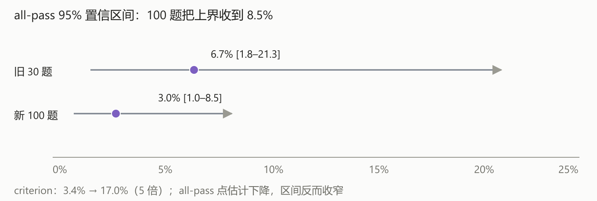

# Harvey LAB firm-knowledge 复测报告（100 题）

日期：2026-10-18　样本：firm-knowledge 001–100（100 题全部判分）
题库：`harvey-firm-knowledge-v1`（250 题 / 2623 条 rubric）　语料：`lab-firm-full`（266 matter / 9007 篇）

## 摘要

| 指标 | 数值 | 95% 置信区间 |
|---|---|---|
| **all-pass**（对外主指标） | **3.0%（3/100）** | **[1.0%, 8.5%]** |
| criterion pass（诊断） | **17.0%** | — |
| 旧 30 题对照（改造前） | all-pass 6.7%（2/30） / criterion 3.4% | [1.8%, 21.3%] |

三句话：

1. 检索改造把 **criterion 从 3.4% 拉到 17.0%**（同 30 题配对：3.4% → 10.2%）；
2. **all-pass 点估计反而降了**（3.0% vs 6.7%），但区间重叠，统计上不能说不降也不能说降；
3. 区间明显收窄：上界从 21.3% 收到 **8.5%**——100 题才看清真实水平在 1%–8.5% 之间。

## 1. 口径

**主口径：外部 harness。** `lab_core.evaluation.scoring.score_rubric`，逐条判、英文 prompt、温度 0，判官 `gpt-5.5`（经网关，关闭 structured output）。一题所有 criterion 全过才记 1。

**对照口径：内部 evals。** `evals_core.runner.rubric_eval`，每批 8 条、中文严格 prompt、判官 Qwen3.8-Flash-Next。48 题时同批复判：all-pass 与外部一致、逐条一致 **96.0%**（316/329）。

**必须对外标注：** 官方默认双判官（`claude-sonnet-4-6` + `gpt-5.5` 平均）；本臂为控成本只用 `gpt-5.5` 单判，与 GLM-Legal 19.2% 不是严格同口径。



## 2. 成绩结构

- all-pass 的 3 题：012, 034, 061——全部是 1–2 条判据的短题；
- **判据数 ≥3 的 85 题，all-pass 全部为 0**；
- 退化输出 8 题（001、021、055、059、067、080、088、095），照旧计入分母；
- 用过 `doc_search` 的 40 题：criterion 25.2%，all-pass 0；
  未用的 60 题：criterion 10.4%，all-pass 3；
- 前 48 题 criterion 12.1%，后 52 题 21.4%（后段工具使用更充分）。

## 3. 与 GLM-Legal 19.2% 的差距归因

all-pass 是合取指标。逐条通过率 p、单题判据数 k 时，all-pass ≈ p^k：

| 逐条通过率 | k=3 | k=5 | k=10 |
|---|---|---|---|
| 17%（当前） | 0.5% | 0.014% | 2e-8 |
| 50% | 12.5% | 3.1% | 0.1% |
| **72%** | 37% | **19%** | 3.7% |

要在中位数 5 条判据的题上达到 19.2%，逐条准确率需要 **约 72%**，当前 17.0%。差距在“逐条精度”，不在“检索召回”。

## 4. 已落地且保留的改造

- `doc_catalog`：从导入清单回填 matter/目录/文件名（266 matter / 9008 篇，不重跑解析）；
- `doc_search`：FTS 按文档聚合、按 matter 出卡；`doc_read`：一次 8 篇按页读；
- L1/L3/L4 工具箱 + 两个内部端点 + 预算闸 160k→120k。

## 5. 未采纳的实验（默认关闭，代码保留）

| 实验 | 结果 |
|---|---|
| v19 系统提示规则 16 | 模型逐字回显题面，4 次复现 → 回退 |
| 候选 matter 卡注入 | 题 001 4/7 → 1/7 / 0/7 → 不用 |
| 检索式注入（P1） | 十题 13.1% → 18.9%，all-pass 0 → 未达门槛 |
| 答案自检（P3） | 十题 16.4%，all-pass 0 → 未达门槛 |
| P1+P3 组合 | 十题 13.1%，all-pass 0 → 互相抵消 |

## 6. 噪声与局限

- 样本是顺序的 001–100，不是随机抽样；后半段（049–100）criterion 更高，存在题目难度差异。
- 8 题退化（回显或 ≤90 字符）计入分母；若剔除，all-pass 不变（3 题都不在退化集）。
- 单判官、判官走网关；与官方双判官口径有已知差异。
- 跑测跨 6 小时，网关时段性拥塞导致多次超时重试（单题最长 4,820 秒），但每题独立 session，无跨题污染。

## 7. 复现

```powershell
python scripts/backfill_doc_catalog.py --library lab-firm-full \
  --manifest data/scratch/harvey-lab/full_import_manifest.jsonl
python data/scratch/harvey-lab/tools/run_angineer_arm_par.py \
  --tasks 001-100 --label angineer-100c --workers 5 --deadline 600 \
  --library lab-firm-full --key-file data/scratch/harvey-lab/runner_key_full.txt
python data/scratch/harvey-lab/tools/grade_arm_par.py --label angineer-100c --workers 3 --judges gpt-5.5
```

## 8. 结论与建议

1. **对外口径**：all-pass **3.0%（n=100，95%CI [1.0, 8.5]）**，criterion 17.0%；注明单判官与 100 题样本。
2. 检索改造的价值在 criterion（3.4% → 17.0%，5 倍），但不足以改变 all-pass 的合取门槛。
3. 中期只做一件事：**逐条证据绑定**（每个断言绑定 doc_id + 页码 + 原句），把逐条准确率从 17% 推向 70% 量级。
4. 不再做：检索侧加码、候选注入、答案自检的反复调参。

## 9. 逐题明细

| 题号 | 判据数 | 通过 | criterion | all-pass | 工具链 | 答案字符 | 退化 | 耗时(s) |
|---|---|---|---|---|---|---|---|---|
| 001 | 7 | 1 | 14% | 否 | knowledge_search | 523 | 是 | 30 |
| 002 | 4 | 0 | 0% | 否 | knowledge_search | 2423 |  | 48 |
| 003 | 3 | 0 | 0% | 否 | knowledge_search + doc_read | 5121 |  | 44 |
| 004 | 2 | 0 | 0% | 否 | knowledge_search + doc_read | 1143 |  | 43 |
| 005 | 6 | 3 | 50% | 否 | knowledge_search + doc_search + doc_read | 5050 |  | 65 |
| 006 | 3 | 1 | 33% | 否 | knowledge_search | 4360 |  | 44 |
| 007 | 3 | 2 | 67% | 否 | knowledge_search + doc_search + doc_read | 4188 |  | 42 |
| 008 | 4 | 0 | 0% | 否 | knowledge_search + doc_read | 4566 |  | 33 |
| 009 | 19 | 1 | 5% | 否 | table_search + doc_search + doc_read + knowledge_search | 2714 |  | 636 |
| 010 | 2 | 0 | 0% | 否 | knowledge_search | 2385 |  | 30 |
| 011 | 19 | 1 | 5% | 否 | knowledge_search | 1581 |  | 23 |
| 012 | 1 | 1 | 100% | 是 | knowledge_search | 4243 |  | 83 |
| 013 | 4 | 0 | 0% | 否 | table_search + doc_search + doc_read + knowledge_search | 3097 |  | 290 |
| 014 | 3 | 0 | 0% | 否 | knowledge_search | 5912 |  | 33 |
| 015 | 3 | 0 | 0% | 否 | knowledge_search + doc_read | 1583 |  | 25 |
| 016 | 14 | 0 | 0% | 否 | knowledge_search | 1418 |  | 70 |
| 017 | 12 | 2 | 17% | 否 | knowledge_search + doc_search + doc_read | 5114 |  | 119 |
| 018 | 1 | 0 | 0% | 否 | knowledge_search + doc_search + doc_read | 2613 |  | 76 |
| 019 | 12 | 0 | 0% | 否 | knowledge_search | 1585 |  | 33 |
| 020 | 3 | 2 | 67% | 否 | knowledge_search + doc_search + doc_read | 2138 |  | 60 |
| 021 | 24 | 1 | 4% | 否 | doc_search + doc_read | 60 | 是 | 96 |
| 022 | 13 | 2 | 15% | 否 | knowledge_search + doc_search + table_search + doc_read | 4070 |  | 184 |
| 023 | 4 | 0 | 0% | 否 | knowledge_search + doc_search + doc_read | 1910 |  | 102 |
| 024 | 9 | 3 | 33% | 否 | knowledge_search + doc_search + doc_read | 1951 |  | 42 |
| 025 | 5 | 1 | 20% | 否 | knowledge_search + doc_search + doc_read | 3528 |  | 54 |
| 026 | 3 | 0 | 0% | 否 | knowledge_search + doc_search + doc_read | 1093 |  | 22 |
| 027 | 7 | 0 | 0% | 否 | knowledge_search | 3244 |  | 28 |
| 028 | 6 | 0 | 0% | 否 | knowledge_search | 7716 |  | 30 |
| 029 | 4 | 0 | 0% | 否 | knowledge_search | 1115 |  | 21 |
| 030 | 6 | 0 | 0% | 否 | knowledge_search | 1817 |  | 27 |
| 031 | 6 | 4 | 67% | 否 | knowledge_search + doc_search | 7130 |  | 36 |
| 032 | 2 | 1 | 50% | 否 | knowledge_search | 3601 |  | 36 |
| 033 | 2 | 0 | 0% | 否 | knowledge_search | 989 |  | 30 |
| 034 | 2 | 2 | 100% | 是 | knowledge_search | 3344 |  | 28 |
| 035 | 5 | 0 | 0% | 否 | knowledge_search | 3442 |  | 24 |
| 036 | 3 | 1 | 33% | 否 | table_search + knowledge_search | 3389 |  | 225 |
| 037 | 2 | 1 | 50% | 否 | knowledge_search + doc_read | 4418 |  | 32 |
| 038 | 15 | 3 | 20% | 否 | knowledge_search + doc_search | 4379 |  | 106 |
| 039 | 25 | 0 | 0% | 否 | knowledge_search | 3890 |  | 26 |
| 040 | 2 | 1 | 50% | 否 | knowledge_search | 498 |  | 23 |
| 041 | 23 | 0 | 0% | 否 | knowledge_search | 7169 |  | 54 |
| 042 | 8 | 1 | 12% | 否 | knowledge_search | 3682 |  | 29 |
| 043 | 11 | 0 | 0% | 否 | knowledge_search | 2237 |  | 25 |
| 044 | 4 | 0 | 0% | 否 | knowledge_search + table_search | 6142 |  | 4820 |
| 045 | 13 | 4 | 31% | 否 | table_search + doc_search + doc_read + knowledge_search | 1783 |  | 1174 |
| 046 | 13 | 2 | 15% | 否 | knowledge_search + table_search | 1338 |  | 250 |
| 047 | 25 | 2 | 8% | 否 | knowledge_search | 9366 |  | 70 |
| 048 | 4 | 2 | 50% | 否 | knowledge_search + doc_search | 6531 |  | 91 |
| 049 | 15 | 2 | 13% | 否 | knowledge_search + table_search + doc_read | 6953 |  | 456 |
| 050 | 29 | 10 | 34% | 否 | knowledge_search + doc_search + doc_read | 12127 |  | 106 |
| 051 | 3 | 1 | 33% | 否 | knowledge_search + doc_search | 2393 |  | 67 |
| 052 | 23 | 4 | 17% | 否 | knowledge_search + doc_search + doc_read | 7381 |  | 159 |
| 053 | 21 | 4 | 19% | 否 | knowledge_search + doc_read | 5448 |  | 94 |
| 054 | 8 | 1 | 12% | 否 | knowledge_search | 2338 |  | 64 |
| 055 | 3 | 1 | 33% | 否 | table_search + doc_search + doc_read + knowledge_search | 90 | 是 | 501 |
| 056 | 2 | 1 | 50% | 否 | knowledge_search | 982 |  | 85 |
| 057 | 5 | 3 | 60% | 否 | table_search + knowledge_search + doc_search | 8537 |  | 340 |
| 058 | 11 | 1 | 9% | 否 | table_search + doc_search + doc_read + knowledge_search | 1953 |  | 454 |
| 059 | 9 | 1 | 11% | 否 | knowledge_search + doc_read | 90 | 是 | 222 |
| 060 | 7 | 0 | 0% | 否 | knowledge_search + doc_read | 3577 |  | 179 |
| 061 | 1 | 1 | 100% | 是 | knowledge_search | 2712 |  | 279 |
| 062 | 10 | 1 | 10% | 否 | knowledge_search + doc_read | 5416 |  | 315 |
| 063 | 11 | 2 | 18% | 否 | knowledge_search + doc_read | 6289 |  | 441 |
| 064 | 9 | 3 | 33% | 否 | knowledge_search + doc_read | 5553 |  | 104 |
| 065 | 6 | 2 | 33% | 否 | knowledge_search + doc_search | 7058 |  | 188 |
| 066 | 9 | 0 | 0% | 否 | knowledge_search + doc_read | 3188 |  | 255 |
| 067 | 7 | 1 | 14% | 否 | knowledge_search + doc_read | 90 | 是 | 107 |
| 068 | 3 | 0 | 0% | 否 | knowledge_search + doc_read | 5843 |  | 184 |
| 069 | 3 | 0 | 0% | 否 | knowledge_search + doc_search | 1696 |  | 134 |
| 070 | 4 | 3 | 75% | 否 | knowledge_search + doc_search | 3713 |  | 172 |
| 071 | 7 | 2 | 29% | 否 | knowledge_search + doc_read | 751 |  | 4272 |
| 072 | 4 | 3 | 75% | 否 | knowledge_search + doc_search | 4528 |  | 136 |
| 073 | 3 | 0 | 0% | 否 | knowledge_search + doc_search | 4249 |  | 108 |
| 074 | 9 | 3 | 33% | 否 | knowledge_search | 2770 |  | 4310 |
| 075 | 13 | 0 | 0% | 否 | knowledge_search | 4565 |  | 106 |
| 076 | 5 | 0 | 0% | 否 | knowledge_search | 1935 |  | 120 |
| 077 | 9 | 1 | 11% | 否 | knowledge_search | 9825 |  | 4461 |
| 078 | 8 | 0 | 0% | 否 | knowledge_search + doc_search + doc_read | 4160 |  | 4358 |
| 079 | 2 | 1 | 50% | 否 | knowledge_search + doc_read | 2560 |  | 187 |
| 080 | 9 | 1 | 11% | 否 | doc_search + doc_read | 60 | 是 | 402 |
| 081 | 3 | 0 | 0% | 否 | knowledge_search | 1338 |  | 188 |
| 082 | 1 | 0 | 0% | 否 | knowledge_search + doc_read | 3604 |  | 191 |
| 083 | 6 | 4 | 67% | 否 | knowledge_search + doc_search + doc_read | 3522 |  | 147 |
| 084 | 18 | 1 | 6% | 否 | knowledge_search | 618 |  | 495 |
| 085 | 6 | 1 | 17% | 否 | knowledge_search | 971 |  | 379 |
| 086 | 7 | 0 | 0% | 否 | knowledge_search | 4817 |  | 271 |
| 087 | 10 | 1 | 10% | 否 | knowledge_search + doc_search + doc_read | 3911 |  | 454 |
| 088 | 4 | 1 | 25% | 否 | knowledge_search + doc_read | 497 | 是 | 72 |
| 089 | 3 | 1 | 33% | 否 | knowledge_search + doc_read | 3353 |  | 244 |
| 090 | 19 | 10 | 53% | 否 | table_search + doc_search + doc_read + knowledge_search | 8345 |  | 557 |
| 091 | 3 | 1 | 33% | 否 | knowledge_search + doc_read | 6233 |  | 172 |
| 092 | 9 | 1 | 11% | 否 | table_search + doc_search + doc_read + knowledge_search | 4227 |  | 564 |
| 093 | 4 | 3 | 75% | 否 | table_search + doc_search + doc_read + knowledge_search | 1461 |  | 473 |
| 094 | 9 | 6 | 67% | 否 | knowledge_search + doc_search + doc_read | 5413 |  | 204 |
| 095 | 4 | 1 | 25% | 否 | knowledge_search + doc_read | 480 | 是 | 70 |
| 096 | 2 | 1 | 50% | 否 | knowledge_search + doc_search + doc_read | 693 |  | 330 |
| 097 | 10 | 2 | 20% | 否 | table_search + doc_search + doc_read + knowledge_search | 5199 |  | 535 |
| 098 | 1 | 0 | 0% | 否 | knowledge_search + doc_read | 4577 |  | 260 |
| 099 | 6 | 1 | 17% | 否 | knowledge_search + doc_search | 8716 |  | 201 |
| 100 | 19 | 0 | 0% | 否 | knowledge_search + doc_search + doc_read | 1491 |  | 229 |

（同表 CSV：[harvey-lab-100-rows.csv](harvey-lab-100-rows.csv)）
