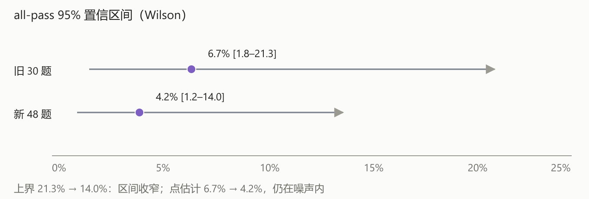
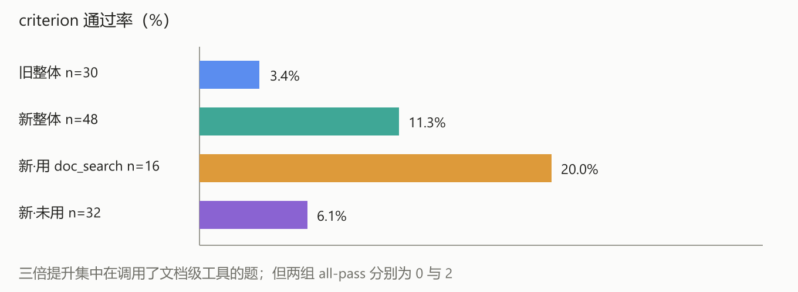
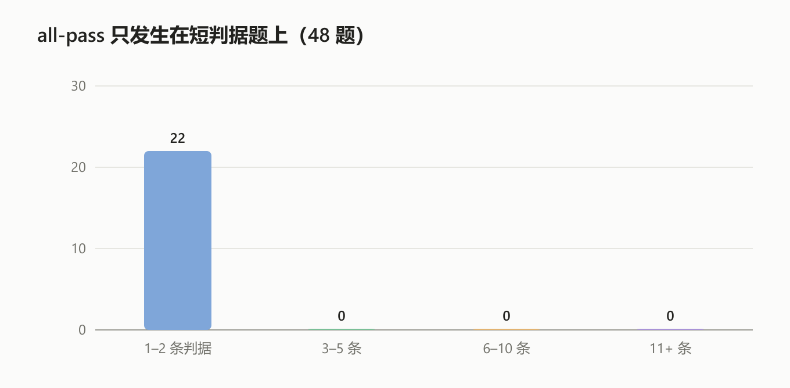

# Harvey LAB firm-knowledge 复测报告（48 题）

> **已被 [100 题版](report-harvey-lab-100-final.md) 取代**（同日补跑 049–100）。本文件保留为中间记录：
> 100 题最终口径为 all-pass 3.0%（95%CI [1.0, 8.5]）、criterion 17.0%。

日期：2026-10-18　样本：firm-knowledge 001–048（连续 48 题，全部判分）
题库：`harvey-firm-knowledge-v1`（250 题 / 2623 条 rubric）　语料：`lab-firm-full`（266 matter / 9007 篇）

## 摘要

| 指标 | 数值 | 95% 置信区间 |
|---|---|---|
| **all-pass**（对外主指标） | **4.2%（2/48）** | [1.2%, 14.0%] |
| criterion pass（诊断） | **11.3%（53/468）** | — |
| 旧 30 题对照（改造前） | all-pass 6.7%（2/30） / criterion 3.4% | [1.8%, 21.3%] |

三句话：

1. 检索改造把 **criterion 从 3.4% 拉到 11.3%**（同 30 题配对：3.4% → 10.2%，9 升 / 2 降 / 19 平）；
2. **all-pass 没有提升**（2/48 对 2/30）：区间上界从 21.3% 收到 14.0%，点估计仍在噪声内；
3. 差距的主因不是检索，而是 **all-pass 的合取性质**——48 题判据中位数 5 条，逐条通过率 11% 时全过概率约万分之一。

## 1. 口径

**主口径：外部 harness。** 判分器 `lab_core.evaluation.scoring.score_rubric`，逐条判、英文 prompt、温度 0，判官 `gpt-5.5`（经网关，关闭 structured output）。一题的所有 criterion 全过才记 1。

**对照口径：内部 evals。** `evals_core.runner.rubric_eval`，每批 8 条、中文严格 prompt、判官 Qwen3.8-Flash-Next。同一批 45 份答卷复判：all-pass 6.7%、criterion 12.2%，与外部逐条一致 **96.0%**（316/329；13 条分歧中 10 条内部偏宽、3 条偏严）。

**必须对外标注的两点：**

- 官方默认是**双判官**（`claude-sonnet-4-6` + `gpt-5.5` 平均，`lab-standard-dual-v1`）；本臂为控成本只用 `gpt-5.5` 单判。GLM-Legal 19.2% 若为双判结果，则不是严格同口径。
- 外部判官的模型版本以网关实际路由为准，`judge_model` 字段只记录请求名。

## 2. 成绩与逐题明细







- all-pass 的 2 题是 012（1 条判据）与 034（2 条判据）；
- 判据数 ≥3 的 39 题 all-pass 全为 0；
- 48 题里 25 题一条 criterion 都没过；
- 用到 `doc_search` 的 16 题 criterion 20.0%，未用的 32 题 6.1%。

| 题号 | 判据数 | 通过 | criterion | all-pass | 工具链 | 答案字符 | 退化 | 耗时(s) |
|---|---|---|---|---|---|---|---|---|
| 001 | 7 | 1 | 14% | 否 | knowledge_search | 523 | 是 | 30 |
| 002 | 4 | 0 | 0% | 否 | knowledge_search | 2423 |  | 48 |
| 003 | 3 | 0 | 0% | 否 | knowledge_search + doc_read | 5121 |  | 44 |
| 004 | 2 | 0 | 0% | 否 | knowledge_search + doc_read | 1143 |  | 43 |
| 005 | 6 | 3 | 50% | 否 | knowledge_search + doc_search + doc_read | 5050 |  | 65 |
| 006 | 3 | 1 | 33% | 否 | knowledge_search | 4360 |  | 44 |
| 007 | 3 | 2 | 67% | 否 | knowledge_search + doc_search + doc_read | 4188 |  | 42 |
| 008 | 4 | 0 | 0% | 否 | knowledge_search + doc_read | 4566 |  | 33 |
| 009 | 19 | 1 | 5% | 否 | table_search + doc_search + doc_read + knowledge_search | 2714 |  | 636 |
| 010 | 2 | 0 | 0% | 否 | knowledge_search | 2385 |  | 30 |
| 011 | 19 | 1 | 5% | 否 | knowledge_search | 1581 |  | 23 |
| 012 | 1 | 1 | 100% | 是 | knowledge_search | 4243 |  | 83 |
| 013 | 4 | 0 | 0% | 否 | table_search + doc_search + doc_read + knowledge_search | 3097 |  | 290 |
| 014 | 3 | 0 | 0% | 否 | knowledge_search | 5912 |  | 33 |
| 015 | 3 | 0 | 0% | 否 | knowledge_search + doc_read | 1583 |  | 25 |
| 016 | 14 | 0 | 0% | 否 | knowledge_search | 1418 |  | 70 |
| 017 | 12 | 2 | 17% | 否 | knowledge_search + doc_search + doc_read | 5114 |  | 119 |
| 018 | 1 | 0 | 0% | 否 | knowledge_search + doc_search + doc_read | 2613 |  | 76 |
| 019 | 12 | 0 | 0% | 否 | knowledge_search | 1585 |  | 33 |
| 020 | 3 | 2 | 67% | 否 | knowledge_search + doc_search + doc_read | 2138 |  | 60 |
| 021 | 24 | 1 | 4% | 否 | doc_search + doc_read | 60 | 是 | 96 |
| 022 | 13 | 2 | 15% | 否 | knowledge_search + doc_search + table_search + doc_read | 4070 |  | 184 |
| 023 | 4 | 0 | 0% | 否 | knowledge_search + doc_search + doc_read | 1910 |  | 102 |
| 024 | 9 | 3 | 33% | 否 | knowledge_search + doc_search + doc_read | 1951 |  | 42 |
| 025 | 5 | 1 | 20% | 否 | knowledge_search + doc_search + doc_read | 3528 |  | 54 |
| 026 | 3 | 0 | 0% | 否 | knowledge_search + doc_search + doc_read | 1093 |  | 22 |
| 027 | 7 | 0 | 0% | 否 | knowledge_search | 3244 |  | 28 |
| 028 | 6 | 0 | 0% | 否 | knowledge_search | 7716 |  | 30 |
| 029 | 4 | 0 | 0% | 否 | knowledge_search | 1115 |  | 21 |
| 030 | 6 | 0 | 0% | 否 | knowledge_search | 1817 |  | 27 |
| 031 | 6 | 4 | 67% | 否 | knowledge_search + doc_search | 7130 |  | 36 |
| 032 | 2 | 1 | 50% | 否 | knowledge_search | 3601 |  | 36 |
| 033 | 2 | 0 | 0% | 否 | knowledge_search | 989 |  | 30 |
| 034 | 2 | 2 | 100% | 是 | knowledge_search | 3344 |  | 28 |
| 035 | 5 | 0 | 0% | 否 | knowledge_search | 3442 |  | 24 |
| 036 | 3 | 1 | 33% | 否 | table_search + knowledge_search | 3389 |  | 225 |
| 037 | 2 | 1 | 50% | 否 | knowledge_search + doc_read | 4418 |  | 32 |
| 038 | 15 | 3 | 20% | 否 | knowledge_search + doc_search | 4379 |  | 106 |
| 039 | 25 | 0 | 0% | 否 | knowledge_search | 3890 |  | 26 |
| 040 | 2 | 1 | 50% | 否 | knowledge_search | 498 |  | 23 |
| 041 | 23 | 0 | 0% | 否 | knowledge_search | 7169 |  | 54 |
| 042 | 8 | 1 | 12% | 否 | knowledge_search | 3682 |  | 29 |
| 043 | 11 | 0 | 0% | 否 | knowledge_search | 2237 |  | 25 |
| 044 | 4 | 0 | 0% | 否 | knowledge_search + table_search | 6142 |  | 4820 |
| 045 | 13 | 4 | 31% | 否 | table_search + doc_search + doc_read + knowledge_search | 1783 |  | 1174 |
| 046 | 13 | 1 | 8% | 否 | - | 0 |  | 0 |
| 047 | 25 | 1 | 4% | 否 | - | 0 |  | 0 |
| 048 | 4 | 1 | 25% | 否 | - | 0 |  | 0 |

（同表 CSV：[harvey-lab-48-rows.csv](harvey-lab-48-rows.csv)）

## 3. 与 GLM-Legal 19.2% 的差距归因

all-pass 是合取指标。设逐条通过率 p、单题判据数 k，则 all-pass ≈ p^k（独立近似）：

| 逐条通过率 | k=3 | k=5 | k=10 |
|---|---|---|---|
| 11%（当前） | 0.13% | 0.0016% | 1e-9 |
| 50% | 12.5% | 3.1% | 0.1% |
| **72%** | 37% | **19%** | 3.7% |

要在中位数 5 条判据的题上达到 19.2%，逐条准确率需要 **约 72%**，当前是 11.3%。这是六倍多的差距，量级上不可能靠“再注入一点上下文”解决。

失败集中在三类：漏 matter、把预案/风险当已发生、以及文档名/编号等细节不匹配。

## 4. 已落地且保留的改造

- `doc_catalog`：从导入清单回填 matter/目录/文件名（266 matter / 9008 篇，不重跑解析）；
- `doc_search`：FTS 命中按文档聚合、按 matter 出卡（题 001：147 篇 / 25 matter，真值 6/6 在卡内）；
- `doc_read`：一次 8 篇按页读，供逐篇确认；
- 接入 L1/L3/L4 工具箱 + 两个内部端点 + 4 条单测；
- 预算闸 160k → 120k（网关 qwen3.6-35b 安全容量 138,146 tokens，155k 会 400）。

## 5. 未采纳的实验（默认关闭，代码保留）

| 实验 | 结果 | 结论 |
|---|---|---|
| v19 系统提示规则 16 | qwen3.6-35b 在工具结果后逐字回显题面，4 次复现 | 回退，不注册 |
| 候选 matter 卡注入 | 题 001 4/7 → 1/7（60 卡）/ 0/7（40 卡） | 模型变保守，不用 |
| 检索式注入（P1） | 十题 criterion 13.1% → 18.9%，all-pass 仍 0 | 未达门槛，默认关 |
| 答案自检（P3） | 十题 16.4%，all-pass 0 | 未达门槛，默认关 |
| P1+P3 组合 | 十题 13.1%（与基线相同），all-pass 0 | 互相抵消，默认关 |

## 6. 噪声与局限

- **48/100**：网关在 12:00–13:40 期间单题最长 4,820 秒，剩余 52 题未跑；样本是连续 001–048，不是随机抽样。
- **2 题退化**（001 回显题面、021 只答 60 字符）已计入分母，未剔除。
- **单判官**、判官走网关；与官方双判官口径有已知差异。
- 评测会话已修正为**每题独立 session**（此前共用 `default` 会累积跨题历史，污染上下文）。

## 7. 复现

```powershell
# 1) 文档级检索元数据（只回填，不重跑解析）
python scripts/backfill_doc_catalog.py --library lab-firm-full   --manifest data/scratch/harvey-lab/full_import_manifest.jsonl

# 2) 跑题（每题独立 session）
python data/scratch/harvey-lab/tools/run_angineer_arm_par.py   --tasks 001-048 --label angineer-100c --workers 2 --deadline 600   --library lab-firm-full --key-file data/scratch/harvey-lab/runner_key_full.txt

# 3) 官方逐条判分
python data/scratch/harvey-lab/tools/grade_arm_par.py --label angineer-100c --workers 2 --judges gpt-5.5

# 4) 内部通道复判（对照口径）
python data/scratch/harvey-lab/tools/rescore_internal.py --arm internal48 --judge Qwen3.8-Flash-Next --label angineer-100c
```

## 8. 建议

1. **对外口径**：all-pass 4.2%（n=48，95%CI [1.2,14.0]），criterion 11.3%；注明单判官与样本范围。
2. **短期**：补跑 049–100（网关空闲时段），把区间再收一档；不改配置。
3. **中期**：把“逐条证据绑定”作为独立项目——每个断言先绑定 doc_id + 页码 + 原句，无证据不写；这是把逐条准确率从 11% 推向 70% 量级的唯一路径。
4. **不再做**：检索侧再加码、候选注入、答案自检的反复调参。
