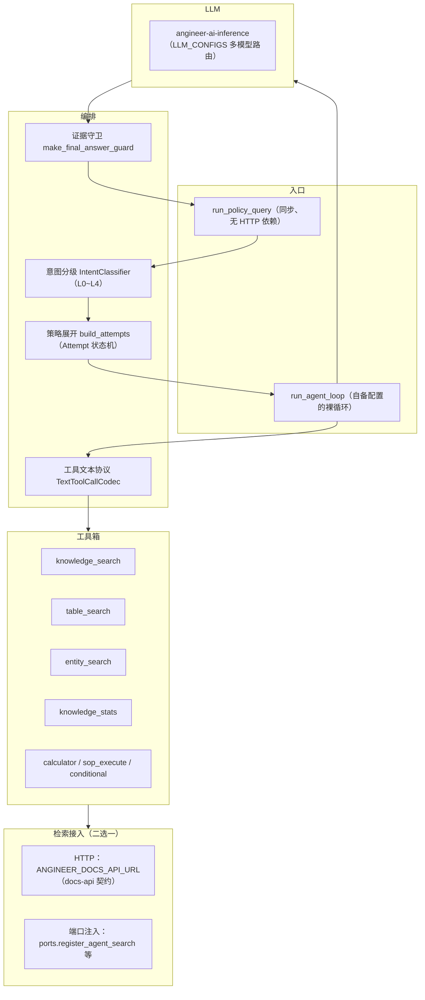

# angineer-core

[](https://pypi.org/project/angineer-core/)

AnGIneer 的问答编排内核（Agent Harness 引擎，纯 Python 库，非服务）：一条
**意图分级 → 策略展开 → 多轮工具调用 → 证据守卫 → 出处标注** 的完整链路。

> 定位：本库**不含 HTTP 服务、不含知识库存储、不含检索配方**。
> LLM 调用交给 [angineer-ai-inference](https://pypi.org/project/angineer-ai-inference/)；
> 检索实现由消费方注入——要么通过端口注册挂进本进程，要么配 `ANGINEER_DOCS_API_URL` 走 HTTP。

## 功能架构



## 安装

```bash
# PyPI（推荐）
pip install angineer-core

# 或从 GitHub 钉版本安装
pip install "angineer-core @ git+https://github.com/0mao0/angineer-core.git@v0.1.1"

# 本地开发（主仓库 AnGIneer 内）
pip install -e services/angineer-core
```

Python 要求 `>=3.10`；依赖：`angineer-ai-inference`、`pydantic>=2.0,<3.0`、
`python-dotenv>=1.0`、`requests>=2.31`、`jsonschema`。

## 快速开始

两步就位：配 LLM（`LLM_CONFIGS`，格式见 [angineer-ai-inference](https://pypi.org/project/angineer-ai-inference/)），
再指一条检索来源——下面是走 HTTP 的最小例子。

```bash
export LLM_CONFIGS='[{"name":"Qwen3.6-A3B","model":"Qwen3.6-35B-A3B-FP8","api_key":"sk-...","base_url":"https://your-gateway/v1","enabled":true,"priority":10}]'
export ANGINEER_DOCS_API_URL="https://your-docs-api"
```

```python
from angineer_core.policy_query import run_policy_query

result = run_policy_query("隧道二次衬砌的最小厚度是多少？", library_id="default")

print(result["answer"])        # 最终回答（含 cite 标记）
print(result["citations"])     # 出处（来自检索项的 page/cite 字段）
print(result["intent"])        # 意图分级结果（L0~L4 / service_mode）
print(result["llm_errors"])    # 空列表＝没有静默降级的 LLM 失败
```

`run_policy_query` 不依赖 HTTP / FastAPI / asyncio，可在后台线程直接调用。
返回值是字典：`answer` / `citations` / `retrieved_items` / `evidences` / `intent` /
`trace_notes` / `stage_timings` / `prompt_versions` / `llm_errors` / `runtime_flags` 等。

## 独立宿主壳（chat-api · `[server]` extra）

内置一个**薄宿主**，把「agent 编排 SSE」直接以服务形态暴露——自部署场景不必再自写宿主层
（壳与 AnGIneer 内部服务同源同行为，代码只在一处维护）：

```bash
pip install "angineer-core[server]"            # 只为此加装 fastapi/uvicorn，纯库用法不变重
export LLM_CONFIGS='[{"name":"...","model":"...","api_key":"...","base_url":"...","enabled":true}]'
export ANGINEER_DOCS_API_URL=http://127.0.0.1:8310
export ANGINEER_DISABLE_LOCAL_FALLBACK=1       # 推荐：检索强制走 HTTP，避免静默空结果
uvicorn angineer_core.server:app --host 127.0.0.1 --port 8311
```

> 注（2026-10-13 外部消费方实踩补）：**env 必须由启动器注入子进程**——壳不读进程 cwd 的 `.env`
> （包内 `load_dotenv()` 的探测起点是包的安装目录，wheel 装在 site-packages 时碰不到你项目根的
> `.env`，能否碰到随 venv 摆放而变、不可依赖）。漏注入是安静坑：启动日志写「HTTP 端口适配器未注册」，
> 随后引用 / 重排 / 条款号归一化全部降级、**全程不报错**；启动后先查一次日志，没有这一行即注入就位。

| 端点 | 说明 |
| :--- | :--- |
| `POST /api/chat/agent` | Agent SSE：`AgentEvent` 帧（每帧含 `frame_version: 1`），首帧 `route_debug`（意图级别 / `classify_ms` / scope），流末 `data: [DONE]` |
| `GET /health` | 探活（检索配置形态 / 鉴权开关状态） |

- 请求体与内部服务同构：`{query, scene?, session_id?, library_id?, library_ids?, doc_ids?, config?, mode?}`；
- 多轮连续性靠进程内会话池（`scene:session_id`，TTL 2h）——不含聊天历史落库（可选面）；
- 可选鉴权：设 `ANGINEER_API_TOKEN`（或 `API_TOKEN`）后，除 `/health` 外要求 `X-API-Key` 头或 `Bearer`；
- 不依赖 SOP 发布面 / chat-history / admin 鉴权，缺之照常启动。

**端口等价物（HTTP 模式 vs 进程内装配）**：壳启动时自动注册 HTTP 端口适配器
（`angineer_core.server.http_ports`；配 `ANGINEER_DOCS_API_URL` 即生效，`ANGINEER_HTTP_PORTS=0` 关闭），
把进程内端口的等价物指向检索服务，行为与进程内装配对齐：

| 端口 | 指向（检索服务端点） | 说明 |
| :--- | :--- | :--- |
| `normalize_query` | `/internal/normalize-query` | 条款号归一化（"第六十条"→"第60条"） |
| `relevant_citations` | `/internal/relevant-citations` | 引用挑选（工具结果 `citations` 键） |
| `local_rerank` | `/internal/rerank` | phrase rerank（排序与相关性档位与内部一致） |
| `local_nodes_loader` | `/internal/doc-nodes` | 节点清单（canonical 查表按文件名找册） |
| `table_blocks` | `/internal/table-blocks` | canonical 表格块读取 |
| `engtool_registry` | `/internal/engtool-run` | 外部工具执行（calculator / conditional；执行体 `angineer-engtools` 需在检索侧安装） |
| knowledge / table / entity / stats 四个 local | 无需适配 | 引擎自身 HTTP 双路已覆盖（retrieve 三模式 / entity-search / stats） |

失败降级原则：适配器网络失败一律降级为原行为（原样返回 / 空列表），绝不把降级路径
变成工具级异常；`table_blocks` 例外（消费方自带 try/except，显式失败上浮为「表格块读取失败」）。

## 两条检索接入路径

引擎只认协议，不认识任何具体检索实现；下表的两种接法效果等价，任选其一。

| 路径 | 怎么接 | 未接时表现 |
| :--- | :--- | :--- |
| **HTTP**（推荐给独立部署） | 配 `ANGINEER_DOCS_API_URL` 指向 docs-api 兼容服务；引擎调 4 个端点：`/api/knowledge/internal/retrieve`、`/internal/entity-search`、`/internal/doc-nodes`、`/internal/graph-append-note` | 未配置则走本地回退（端口路径） |
| **端口注入**（推荐给嵌入式） | 进程内调 `angineer_core.ports.register_*`，把自家检索实现挂上 | 未注册的端口按降级语义走「警告 + 空结果」，对应工具不可用 |

```python
from angineer_core import ports

ports.register_local_nodes_loader(lambda library_id, doc_ids: my_nodes(library_id, doc_ids))
ports.register_local_rerank(lambda query, task_type, candidates: my_rerank(query, task_type, candidates))
ports.register_agent_search(
    normalize_query=my_normalize_query,      # "第六十条" → "第60条"，不接则原样透传
    knowledge_local=my_knowledge_search,     # 只做正文问答时，这个端口是必需的
    table_local=my_table_search,
    entity_local=my_entity_search,
    local_stats=my_local_stats,
    engtool_registry=my_tool_registry,       # calculator / conditional 等外部工具
    relevant_citations=my_relevant_citations,
    table_blocks=my_table_blocks,
)
```

只做正文问答（不查表、不查图谱、不做统计）的最小实现 = **两个端口**：

- `knowledge_local`：召回本体（必需）；
- `local_nodes_loader`：文档清单（`local_nodes_loader(library_id, doc_ids)`）。它决定证据文本前的
  `《标题》` 前缀，也决定 `doc_ids` 收窄是否生效——**清单为空时按 docs-core 配方的召回恒空**
  （`dense_retriever` 见空 nodes 直接返回 `[]`），表现为整库拒答。自家召回实现若不依赖文档清单，
  也必须让检索项自带标题（见下条契约）。

表格题 / 实体查 / 统计题 / 引用挑选 / SOP / 计算器各自是独立端口，按需补齐。

**检索项契约**（换任何实现都要守，缺字段只会静默退化、不报错）：

- `item_id` / `doc_id` / `title` / `text` / `score` / `metadata` 字段齐全；
- **`metadata.doc_title` 必带**（或让 `text` 自带 `《标题》`）：引擎据此给证据文本拼 `《书名》` 前缀；
  出处守卫用「证据里出现过的书名号标题」核对答案里的引用，**证据侧一个标题都没有时，
  答案里任何 `《…》` 引用都会被判编造、整段替换为拒答**（`has_unsupported_reference`，逐条硬拦会误杀，
  所以口径是「全部核不到才拦」）；
- 页码等定位字段随 `metadata` 透传，`citations` 由引擎按检索顺序分配标注。

## 意图分级与策略展开

`IntentClassifier` 输出 L0~L4，`build_attempts` 按级别展开尝试序列（前一级失败自动降级到下一级）：

| 级别 | 含义 | Attempt 序列 |
| :--- | :--- | :--- |
| L0 | 闲聊 / 寒暄 | 直答（不调工具） |
| L1 | 正文问答 | 语义检索（`enforce_evidence=True`，无证据拒答） |
| L2 | 条款 / 表格定位 | `table_search` 优先，无证据降级 L1 |
| L3 | 规范计算 | 复杂档：QA 三件套 + `sop_execute` + `calculator` + `conditional`，最多 8 轮 |
| L4 | 复杂综合 | 同 L3（复杂档只按 level 记标签，编排一致） |

## 事件协议

`run_agent_loop` 通过 `emit` 回调吐 `AgentEvent(type, run_id, turn, ts, payload)`：

```text
run_start / run_end
turn_start / turn_end
message_start / message_delta / message_end
tool_start / tool_end
note（过程说明） / answer（守卫替换后的最终回答） / error
```

按 `run_id` 归并以还原「思考过程（N 步 · 工具耗时 X）」；`meta` 字段永不进 LLM 上下文。

### `run_end.payload.citations`（引用集契约）

`run_end` 的 payload 带 `citations`：**本轮实际参考的证据集合**（跨轮、跨工具按
`target_id + marker` 去重）。它是服务端判定的结果，**与模型有没有在正文写 `[K1]` 标记无关**——
标记只决定「句级定位挂不挂」，参考集本身不受标记影响。

为什么要分开：模型照抄 `cite` 标记是概率性遵从（同一模型同一题，一次写 4 个标记、一次 0 个）。
宿主若把「来源列表」绑在标记上，模型不写标记时出处会整块消失——这是 2026-10-30 之前
AnGIneer 自身的实际故障形态，现已由该字段解耦。

| 字段 | 说明 |
| :--- | :--- |
| `target_id` | 证据目标 id（点击跳原文用） |
| `doc_id` / `doc_title` | 文档 id / 文件名（表格条目可能是「表 4.4.3 …」） |
| `marker` | 引用标记（`K1`/`T1`），正文写同名标记即可对上 |
| `page_idx` / `page_label` / `section_path` | 定位信息 |
| `snippet` | 证据片段（前 200 字） |
| `score` / `fusion_sources` | 相关性与融合来源 |

最小消费（宿主侧）：

```js
const res = await fetch('/api/chat/agent', {
  method: 'POST',
  headers: { 'Content-Type': 'application/json' },
  body: JSON.stringify({ query, scene: 'qa', session_id, library_id }),
})
const reader = res.body.getReader()
const decoder = new TextDecoder()
let buf = ''
let citations = []
let answer = ''
for (;;) {
  const { done, value } = await reader.read()
  if (done) break
  buf += decoder.decode(value, { stream: true })
  const parts = buf.split('\n\n')
  buf = parts.pop() || ''
  for (const part of parts) {
    if (!part.startsWith('data: ')) continue
    const raw = part.slice(6)
    if (raw === '[DONE]') break
    const event = JSON.parse(raw)
    if (event.type === 'message_delta') answer += event.payload?.delta || ''
    if (event.type === 'run_end') {
      citations = event.payload?.citations || []   // ← 参考集在这里
      answer = [...(event.payload?.messages || [])].reverse()
        .find(m => m.role === 'assistant' && !m.tool_calls)?.content || answer
    }
  }
}
// 行内定位：只挂正文真实出现过的标记；参考集本身照常展示
const used = new Set([...answer.matchAll(/\[\s*([KTE]\s*\d+)\s*\]/g)].map(m => m[1].replace(/\s+/g, '')))
const inline = citations.filter(c => c.marker && used.has(c.marker))
```

- **持久化**：把 `citations` 存进该轮 assistant 消息的 meta（AnGIneer 自身即如此），
  历史回放读同一份，避免「实时有来源、回放没有」；
- **多库场景**：`citations` 不带 `library_id`，宿主需用同轮工具消息 `items[].metadata.library_id`
  按 `marker` 回填，否则非首库文档的跳转会 404；
- **兼容**：旧版本没有该字段，按空数组处理；此时若要兜底，可退回「按正文标记过滤」的旧行为。

## 证据守卫

`make_final_answer_guard(enforce_evidence)` 在回答出栈前做四道检查：

1. 全程没有有效证据 → 拒答；
2. 答案引用未检索到的规范编号 / 书名号标题 → 替换为拒答话术（标题类为「全部核不到才拦」，部分核到的次级引用放行）；
3. 编造 `[KTE]` 标记 → 移除标记，不拒答；
4. 已有证据却整段拒答 → 终段定向重试一次，仍拒答则保留原文并留 trace 注记。

## 环境变量

配置全部来自环境变量；LLM 侧变量（`LLM_CONFIGS` / `ANGINEER_*` 超时重试等）见
angineer-ai-inference README，这里只列引擎自身常用的：

> 注：本库与其依赖 `angineer-ai-inference` 在 **import 时**各按 python-dotenv 规则
> 加载一次 `.env`（`override=False`，已存在的环境变量不被覆盖）。探测起点是**包的安装目录**、
> 不是进程 cwd——`pip` 装进 site-packages 后你项目根的 `.env` 通常读不到，独立部署请显式注入 env。
> 宿主若希望环境完全自控，在 import 前设好变量即可。

| 变量 | 默认 | 说明 |
| :--- | :--- | :--- |
| `ANGINEER_DOCS_API_URL` | 空 | docs-api 基址；配了就优先走 HTTP 检索 |
| `ANGINEER_DOCS_API_TIMEOUT` | 30 | docs-api 请求超时（秒） |
| `ANGINEER_DISABLE_LOCAL_FALLBACK` | 0 | 置 1 时禁止本地回退（HTTP 失败即空结果，不发跨进程直读） |
| `ANGINEER_CONTEXT_TOP_N` | 15 | rerank 后进上下文的证据条数上限 |
| `ANGINEER_QA_PROMPT_VERSION` | latest | QA 档提示词版本（`v17` / `latest`，随包发布） |
| `ANGINEER_FIRST_TOKEN_LIVENESS_S` | 90 | 流式首字存活线（秒），0 = 关闭；防上游挂起不返回 |
| `ANGINEER_ROUTE_PARALLEL` | true | 赌博式预检：请求进来就并行预跑一次 L1 检索 |
| `ANGINEER_EAGER_COMPRESS` | false | 激进压缩开关：每轮即压跨对话证据，不等预算阈值 |
| `ANGINEER_OPS_DIR` | 树内 `data/ops` | 观测 jsonl（TTFT / 工具耗时 / 检索分段）落盘目录；**不在主仓库树里（pip 安装）且未显式配置时默认不落盘**——库不往宿主工作目录写文件 |
| `ANGINEER_OPS_DISABLE` | 空 | 置 `1` 整体停用观测落盘（优先级高于 `ANGINEER_OPS_DIR`） |
| `ANGINEER_LOG_LEVEL` | INFO | 日志级别 |

## 不在本库范围

- HTTP / SSE 服务端点（由消费方实现；可选装 `[server]` extra 得到一条薄壳 chat-api，见上）；
- 知识库存储、向量检索、rerank、解析入库（由消费方或 docs-api 提供）；
- 会话池与聊天历史持久化（本库给 `AgentSession` 结构，落库由消费方决定；`[server]` 壳用进程内池）；
- LLM 客户端本身（走 angineer-ai-inference）。

## 开发与测试

```bash
pip install -e ".[dev]"
python -m pytest tests -q
```

测试覆盖：意图分类降级、策略展开、工具箱组成、答案形态注入、上下文截断、
证据指针与跨轮压缩、多库作用域与检索 memo、检索端口双轨、独立宿主壳管道（health / 鉴权门 / SSE 帧协议）。
依赖 docs-core 的集成用例在未安装 docs-core 的环境自动跳过。

架构说明（Agent Harness 详解、工具协议、关键踩坑）见主仓库
[docs/angineer-core/agent-harness.md](https://github.com/0mao0/AnGIneer/blob/main/docs/angineer-core/agent-harness.md)。

## 许可

MIT
